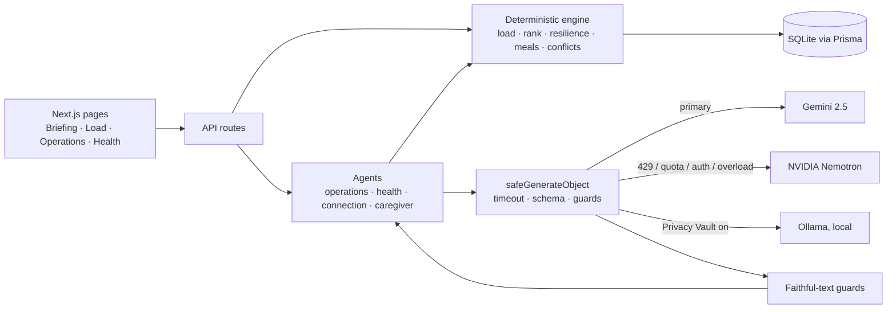
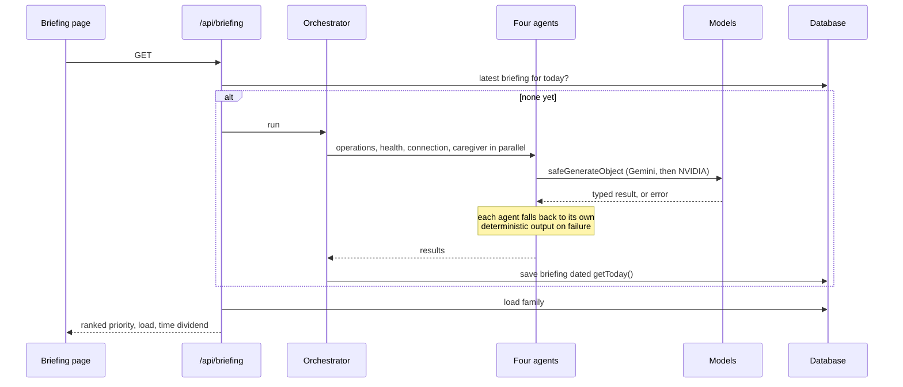

# Bayt

Live: https://bayt.reilabs.cc/

Bayt is a family operating system for Gulf households. It sees the invisible coordination work in a home, finds where the household is fragile, and redistributes work with the consent of the people involved.

The principle behind every screen: **code decides, the model writes.** Load, ranking, conflicts, resilience and diet checks are deterministic and tested. A model only phrases what the code has already established, and its output is checked before it reaches the screen.

The full feature reference is in [`docs/FEATURES.md`](docs/FEATURES.md). The working guide for contributors is [`CLAUDE.md`](CLAUDE.md).

## Quick start

```bash
npm install
cp .env.local.example .env.local      # then fill in the keys below (all optional, see Demo mode)
cp .env.local.example .env            # Prisma's CLI reads .env only; it needs DATABASE_URL
npx prisma migrate deploy
npm run seed                           # the Al-Mazrouei demo family
npm run dev                            # http://localhost:3000
```

| Command | What it does |
|---|---|
| `npm run dev` | Dev server (Turbopack) |
| `npm run build` | Production build |
| `npm test` | Vitest unit tests for the deterministic engine |
| `npm run lint` | ESLint |
| `npm run seed` | Seed the demo family, dated relative to today |

## Environment

| Variable | Purpose |
|---|---|
| `DATABASE_URL` | SQLite file, for example `file:./dev.db` |
| `GOOGLE_GENERATIVE_AI_API_KEY` | Gemini, the primary model |
| `NVIDIA_API_KEY` | Nemotron fallback, used on rate limit, quota, auth or overload errors. Also the only model that reads inbox documents (PDFs are turned into text on the server first) |
| `PRIVACY_VAULT_ENABLED` | Start with health analysis on the local model |
| `OLLAMA_BASE_URL` | Local model for the Privacy Vault |
| `NEXT_PUBLIC_DEMO_MODE` | `true` runs with no model calls and shows the date simulator |

Nothing throws when a key is missing. The app boots, says which key is absent, and uses its built-in plan, ranking and wording.

## Demo mode

`NEXT_PUBLIC_DEMO_MODE=true` skips every model call. The same deterministic code runs against the seeded database, so the numbers are real and only the wording is plain. In demo mode the top bar shows a **date simulator** with presets for Ramadan, Eid al-Adha, summer heat and dust season. It changes the season, meals, load window and cultural banner. Seeded events stay anchored to the real date.

## Privacy by design

- **Constraint mapper.** Meal prompts get derived constraints such as "low sodium" or "nut free", never a diagnosis or a medication name.
- **Faithful-text guards.** Model wording is accepted only if it keeps every figure and adds none. Otherwise the deterministic text is used.
- **Privacy Vault.** When on, health analysis runs on the local model only and fails closed: if that model is down, Bayt writes the summary from the records itself rather than going to the cloud.
- **Consent first.** Handoffs and extracted tasks are proposals. Nothing is saved or reassigned until the person confirms.
- **No identity by name.** Members are matched by id and role, and `mem_*` ids never reach the interface.

## Architecture



### Briefing generation



## Tests

`npm test` covers the deterministic modules: the load model, absence simulation and bus factor, handover plans, priority ranking, Time Dividend, date extraction from documents, meal constraints and the plan validator, cultural context on fixed dates, the faithful-text guards, the environment check and the date simulator hook.

## Stack

Next.js 15, React 19, TypeScript, Tailwind v4, Prisma 7 with SQLite, Vercel AI SDK v6, Zod, Zustand, Framer Motion, Vitest.
